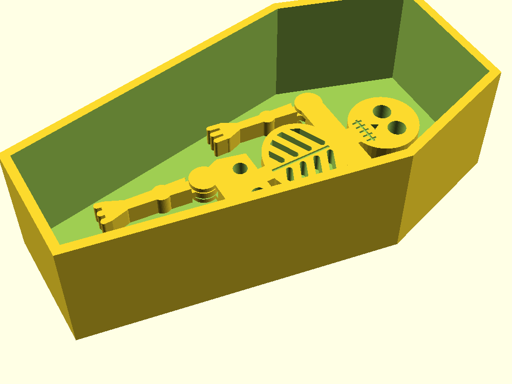
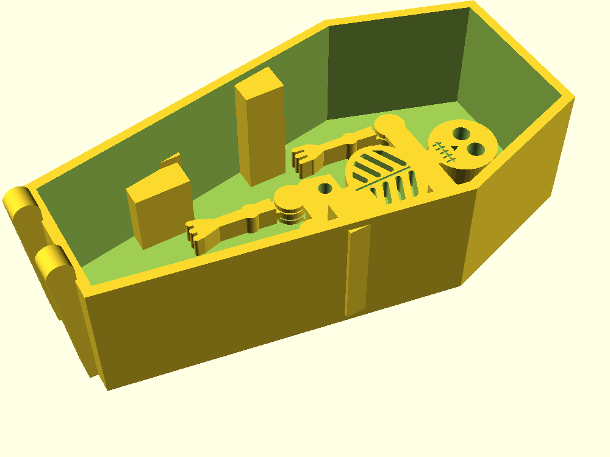

# Rise and Shine — crank automaton coffin

Entry for the Printables "Halloween 2026: Make It Move" flash contest
(deadline 2026-11-01 23:59 UTC). A coffin box with a hand crank on the side:
turn it and the skeleton sits up and pushes the lid open, then lies back down
and the lid falls shut. His arms hang on free shoulder pivots, so they droop to
the coffin floor when he lies flat and swing as he rises; his legs are a
drop-in false floor over the foot end that also hides the mechanism.
Status: **v2 designed, unprinted.**

## Mechanism

Crank-rocker four-bar, all pin joints, nothing relies on friction:

| link | value |
|---|---|
| crank throw `r` | 6.5 mm |
| conrod `c` | 30 mm |
| rocker arm `a` (hip pivot to conrod pin) | 14 mm |
| ground `g` (crankshaft to hip pivot) | 30 mm, crank 14 mm below the hip |
| torso swing | 0° (flat) to 55° |
| worst transmission angle | 56° |

The rocker arm is a pair of cheeks hanging 28° behind straight-down from the
hip pivot, so the bottom of the symmetric ±28° swing is "lying flat". The lid is
hinged at the foot end; the top corner of the head lifts it to about 24°. Both
torso directions are driven; only the lid closes by gravity.

## Parts and print orientation

Every part exports (`part=`) in its print orientation and passed `dfm_check`
support-free. The three axles are printed 3 mm pins with 6 mm heads and the
crank shaft is a printed 5 mm D-pin with an 8 mm head (all four in `pins`), so
no filament or hardware is needed.

| part | prints | notes |
|---|---|---|
| `box` | floor down | hip bosses locate the torso in Y; crank bearing boss + outer pad; hinge knuckles with 45° roofs and ribs down the foot end |
| `lid` | top up | centre knuckle, notches for the box knuckles, raised crescent moon (`moon_phase` = crescent \| quarter, `moon_rot`, `moon_bite`) |
| `torso` | face down | skeleton: skull, clavicle, see-through ribcage, pelvis; rocker cheeks point up; engraved face/teeth/sternum are crisp against the bed |
| `arm` | flat, **print 2** | bone arm with hand, free on a shoulder pin; pin head countersunk in the outboard face (flip one arm over) |
| `legs` | flat | false floor for the foot end, rests on wall ledges at z 23.5; leg bones in 2 mm relief; drops in last and lifts out |
| `conrod` | flat | 3.4 mm big end on the 3 mm crank stub, 3.5 mm small end; constant-width bar so it never sweeps into the crankshaft |
| `crank` | web down | crank web with a press-fit D-bore and the 3 mm crank-pin stub standing up |
| `handle` | flat | press-fit D-bore |
| `pins` | heads down | hip 53.9 mm, fork 10.1 mm, lid 24 mm, 2 × shoulder 11.8 mm (3 mm, 6 mm heads) and the 24.5 mm crank shaft (5 mm D-pin, 8 mm head) |

Crank-side stack, from the wall inward: outer pad, wall, bearing boss, crank
web, then the conrod on the web's stub, then the torso's fork. Nothing but the
stub sits in the conrod's plane, so the rod can swing across the shaft axis at
crank 180° without hitting anything (the first layout had the rod between the
web and the bearing, and `fit_check` at 180° caught it sweeping into the shaft).

Pin holes: 3.5 mm where the pin turns (torso hip, conrod, lid knuckle, arms),
3.25 mm where it should stay put (box walls, rocker cheeks, box knuckles, the
torso's shoulder bore). Printed holes
come out small, so expect to ream or sand on the first print and then adjust
`pin_slip` / `pin_grip`.

## Assembly

1. Drop the torso in the box (cheeks toward the crank side), push the hip pin
   through from the side opposite the crank; its head seats in the countersink.
2. Hook the conrod's big end over the crank web's stub and lower both into the
   box with the web next to the bearing boss.
3. Pin the conrod's small end between the torso's cheeks (short pin, head on
   the outer cheek). The fork now holds the rod on the stub axially.
4. Slide the handle onto the crank shaft, then push the shaft in from outside
   through the pad, wall and bearing boss and press it into the web's D-bore,
   turning the web to line up the flat. The shaft head sits on the hub.
5. Arms: one on each side of the clavicle, hand toward the feet, countersink
   outboard; short pin through each arm into the torso.
6. Drop the legs plate onto the ledges at the foot end (sacrum toward the hip).
7. Lid on, long pin through the three knuckles from the side opposite the crank;
   the lid is notched for its head.

The arms need no stops: with the torso flat they rest on the floor at about
45°, and from 7° of sit-up onward they hang straight down. They never swing
forward of the body line under gravity, so the lid always closes.

## Clearances (checked with `fit_check` over the crank cycle)

| pair | gap |
|---|---|
| torso ↔ box | 0.5 mm per side |
| conrod ↔ cheeks | 0.3 mm per side |
| conrod ↔ crank stub | 0.2 mm radial |
| conrod ↔ crank web (any angle) | 0.2 mm |
| conrod ↔ shaft tip | 0.3 mm |
| pins ↔ turning bores | 0.25 mm radial |
| crank shaft ↔ bearing bore | 0.2 mm radial |
| shaft ↔ web and handle D-bores | 0.05 mm press |
| handle ↔ flared side wall | 0.5 mm at the knob |
| lid ↔ skull top (at rest) | 3.1 mm |
| arms ↔ side walls / torso / floor | ≥ 0.5 mm over the cycle |
| legs plate ↔ crank web (top of sweep) | 1.5 mm |
| legs plate ↔ torso and cheeks | ≥ 2.9 mm over the cycle |

`coffin_box.scad`, `coffin_part.scad` and `coffin_part2.scad` are wrappers so
`fit_check` can pit the box against one positioned part (`which`, `al`) or two
positioned parts against each other (`which` vs `which2`). `-D` overrides do not
reach a `use`d file, which is the whole trick.

## Todo before entry

- Cosmetics: lid bevel and plank lines, crank knob as a skull or bone, maybe a
  bone-white skeleton in a black box on the XL.
- Print on the XL in two colours (black box/cape, bone face), tune the hip and
  crank fits from the first print and record them as a profile.
- Photos, a short video loop, assembly steps for the listing.

## Little skeleton (separate figure)

`little_skeleton.scad` → `stl/little_skeleton.stl`: a flat 93 × 46 × 5.6 mm
skeleton that lies in a coffin. One print, no supports, no assembly: the
shoulders and hips are print-in-place hinges. The torso owns a fork (bottom
plate, top plate and a 3 mm pin); each limb's end is a disc in the middle layer
turning on that pin, with 0.4 mm gaps above, below and around it. Twist each limb
gently after printing to break the joints free. Use 0.2 mm layers.

The arms swing from the print pose out to at least 40° and the legs to 30°
with the 0.4 mm clearance intact. It fits a plain coffin of this outline with
the feet about 42 mm in from the foot end (`skel_in_coffin.scad`); it does not
fit the automaton box, whose hip bosses and crank take that space.

### Sized for the first crank coffin

`stl/little_skeleton_88.stl` is the same figure at 88% (`sc = 0.88`; the joint
pins, gaps and thickness stay full size). It lies in the first version of the
crank box (`coffin_v1.scad`, the box with hip bosses at ±18.5 mm and no crank
parts installed) with 1.9 mm to spare: feet toward the foot end, about 27 mm
from the centre, arms head-side of the hip bosses
(`skel_in_coffin_v1.scad`). The current box has its hip bosses closer in, at
±15.5 mm, so this placement is for the first box only.

