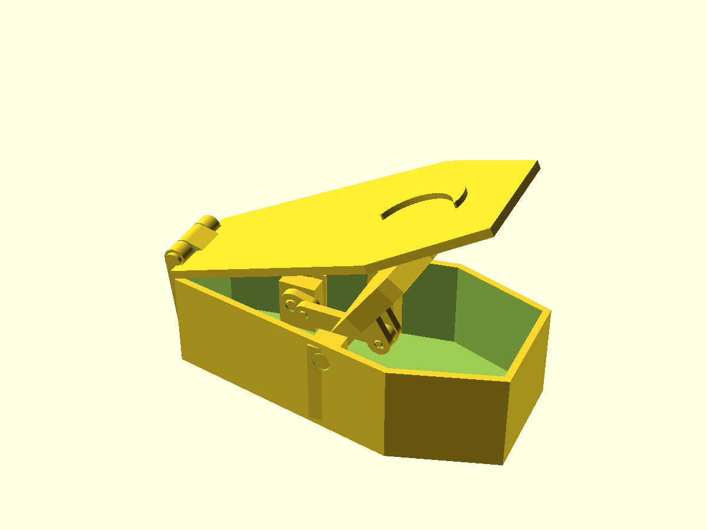
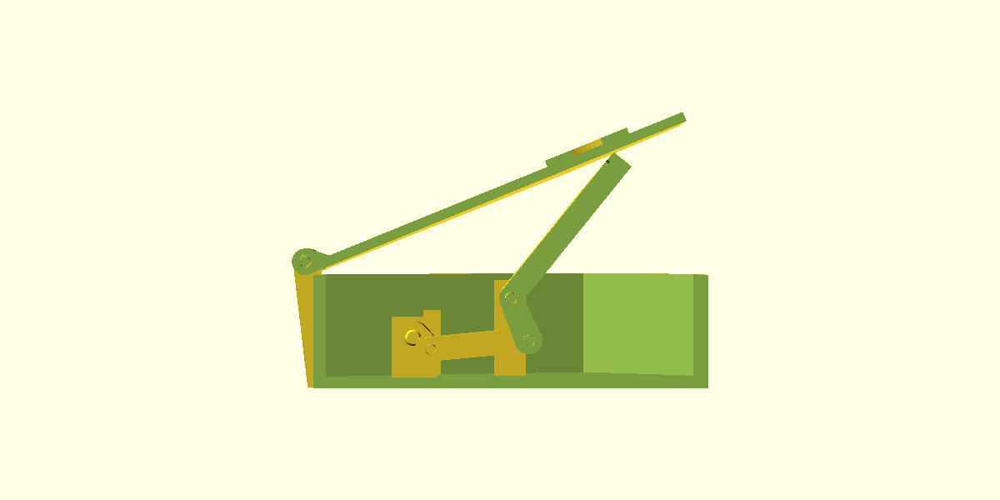
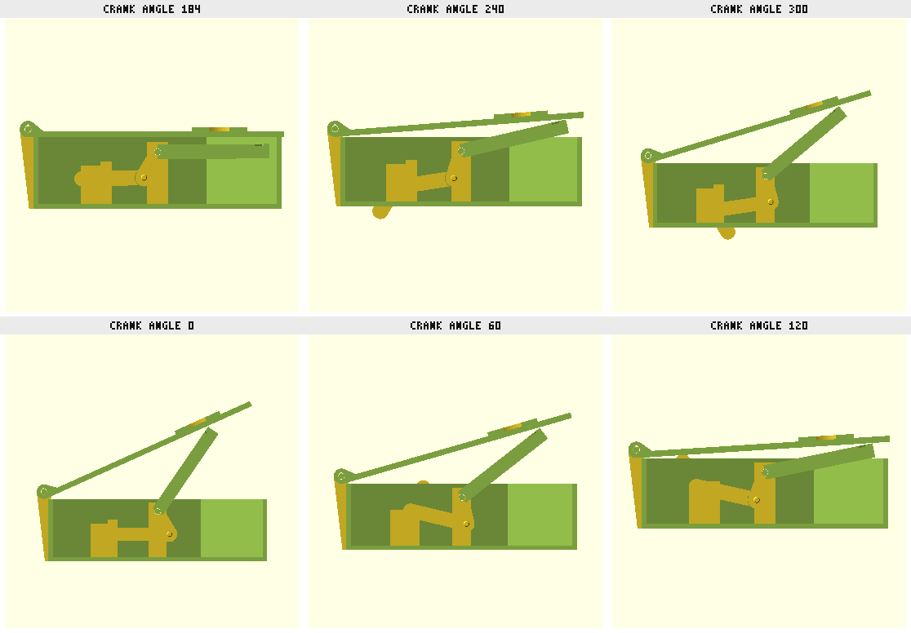

# Dracula Rises — crank automaton coffin

Entry for the Printables "Halloween 2026: Make It Move" flash contest
(deadline 2026-11-01 23:59 UTC). A coffin candy box with a hand crank on the
side: turn it and the vampire sits up and pushes the lid open, then lies back
down and the lid falls shut. Status: **v1 designed, unprinted.**

## Mechanism

Crank-rocker four-bar, all pin joints, nothing relies on friction:

| link | value |
|---|---|
| crank throw `r` | 6.5 mm |
| conrod `c` | 30 mm |
| rocker arm `a` (hip pivot to conrod pin) | 14 mm |
| ground `g` (crankshaft to hip pivot) | 30 mm, crank 14 mm below the hip |
| torso swing | 0° (flat) to 55° |
| worst transmission angle | 56° |

The rocker arm is a pair of cheeks hanging 28° behind straight-down from the
hip pivot, so the bottom of the symmetric ±28° swing is "lying flat". The lid is
hinged at the foot end; the top corner of the head lifts it to about 24°. Both
torso directions are driven; only the lid closes by gravity.

## Parts and print orientation

Every part exports (`part=`) in its print orientation and passed `dfm_check`
support-free. The three axles are printed 3 mm pins with 6 mm heads and the
crank shaft is a printed 5 mm D-pin with an 8 mm head (all four in `pins`), so
no filament or hardware is needed.

| part | prints | notes |
|---|---|---|
| `box` | floor down | hip bosses locate the torso in Y; crank bearing boss + outer pad; hinge knuckles with 45° roofs and ribs down the foot end |
| `lid` | top up | centre knuckle, notches for the box knuckles, raised crescent moon (`moon_phase` = crescent \| quarter, `moon_rot`, `moon_bite`) |
| `torso` | face down | rocker cheeks point up; engraved face is crisp against the bed |
| `conrod` | flat | 3.4 mm big end on the 3 mm crank stub, 3.5 mm small end; constant-width bar so it never sweeps into the crankshaft |
| `crank` | web down | crank web with a press-fit D-bore and the 3 mm crank-pin stub standing up |
| `handle` | flat | press-fit D-bore |
| `pins` | heads down | hip 53.9 mm, fork 10.1 mm, lid 24 mm (3 mm, 6 mm heads) and the 24.5 mm crank shaft (5 mm D-pin, 8 mm head) |

Crank-side stack, from the wall inward: outer pad, wall, bearing boss, crank
web, then the conrod on the web's stub, then the torso's fork. Nothing but the
stub sits in the conrod's plane, so the rod can swing across the shaft axis at
crank 180° without hitting anything (the first layout had the rod between the
web and the bearing, and `fit_check` at 180° caught it sweeping into the shaft).

Pin holes: 3.5 mm where the pin turns (torso hip, conrod, lid knuckle), 3.25 mm
where it should stay put (box walls, rocker cheeks, box knuckles). Printed holes
come out small, so expect to ream or sand on the first print and then adjust
`pin_slip` / `pin_grip`.

## Assembly

1. Drop the torso in the box (cheeks toward the crank side), push the hip pin
   through from the side opposite the crank; its head seats in the countersink.
2. Hook the conrod's big end over the crank web's stub and lower both into the
   box with the web next to the bearing boss.
3. Pin the conrod's small end between the torso's cheeks (short pin, head on
   the outer cheek). The fork now holds the rod on the stub axially.
4. Slide the handle onto the crank shaft, then push the shaft in from outside
   through the pad, wall and bearing boss and press it into the web's D-bore,
   turning the web to line up the flat. The shaft head sits on the hub.
5. Lid on, long pin through the three knuckles from the side opposite the crank;
   the lid is notched for its head.

## Clearances (checked with `fit_check` over the crank cycle)

| pair | gap |
|---|---|
| torso ↔ box | 0.5 mm per side |
| conrod ↔ cheeks | 0.3 mm per side |
| conrod ↔ crank stub | 0.2 mm radial |
| conrod ↔ crank web (any angle) | 0.2 mm |
| conrod ↔ shaft tip | 0.3 mm |
| pins ↔ turning bores | 0.25 mm radial |
| crank shaft ↔ bearing bore | 0.2 mm radial |
| shaft ↔ web and handle D-bores | 0.05 mm press |
| handle ↔ flared side wall | 0.5 mm at the knob |
| lid ↔ head top (at rest) | 3.4 mm |

`coffin_box.scad`, `coffin_part.scad` and `coffin_part2.scad` are wrappers so
`fit_check` can pit the box against one positioned part (`which`, `al`) or two
positioned parts against each other (`which` vs `which2`). `-D` overrides do not
reach a `use`d file, which is the whole trick.

## Todo before entry

- Sculpt: a real vampire (cape, collar, widow's peak, two-tone pale face), coffin
  lid bevel and plank lines, crank knob as a skull or bone.
- Print on the XL in two colours (black box/cape, bone face), tune the hip and
  crank fits from the first print and record them as a profile.
- Photos, a short video loop, assembly steps for the listing.
